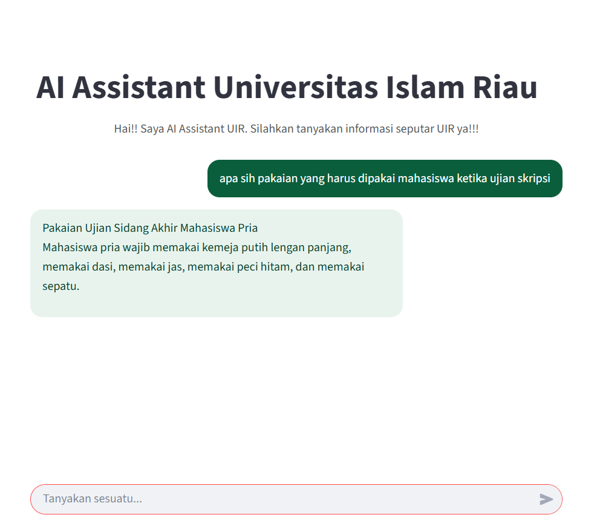
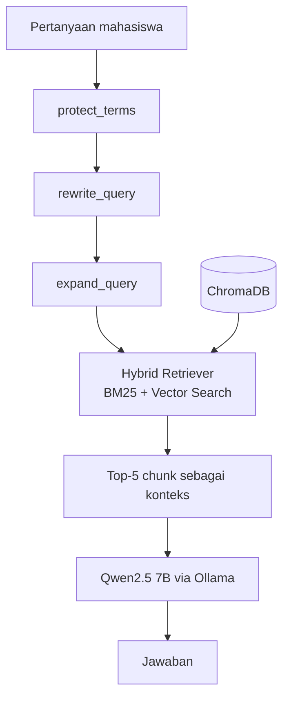

# AI Assistant Universitas Islam Riau

Chatbot berbasis **Hybrid RAG** yang menjawab pertanyaan mahasiswa seputar
Universitas Islam Riau berdasarkan dokumen resmi: pedoman akademik, UKT,
beasiswa, kalender akademik, panduan KP dan TA, serta layanan administrasi.
Proyek ini dikembangkan sebagai skripsi Teknik Informatika.



## Latar Belakang
[2-3 kalimat: masalahnya apa. Contoh: informasi akademik tersebar di banyak
dokumen sehingga mahasiswa sulit menemukannya.]

## Fitur Utama
- Hybrid retrieval: [BM25 + vector search, dan cara menggabungkannya]
- Pemrosesan query: perlindungan istilah khusus, query rewriting, query expansion
- LLM lokal (Qwen2.5 7B via Ollama), tanpa biaya API
- Antarmuka chat dengan Streamlit
- Evaluasi retrieval menggunakan MRR

## Arsitektur



Proses indexing (dijalankan sekali): data JSON yang sudah di-chunk →
embedding → disimpan ke ChromaDB.

## Hasil Evaluasi

Dievaluasi dengan [jumlah] pertanyaan di `data/eval/eval_questions.json`.

| Metode | MRR |
|---|---|
| BM25 saja | [...] |
| Vector search saja | [...] |
| Hybrid | [...] |

[Satu kalimat kesimpulan, misalnya hybrid lebih tinggi X poin dibanding metode tunggal.]

## Teknologi
Python, ChromaDB, BM25, Ollama (qwen2.5:7b), Streamlit

## Cara Menjalankan

1. Install [Ollama](https://ollama.com), lalu:
   ```bash
   ollama pull qwen2.5:7b
   ```
2. Install dependensi:
   ```bash
   pip install -r requirements.txt
   ```
3. Buat index vektor (sekali saja):
   ```bash
   python -m src.ingest.embed_data
   ```
4. Jalankan aplikasi:
   ```bash
   streamlit run app/streamlit_app.py
   ```
5. Jalankan evaluasi:
   ```bash
   [perintah evaluasi Anda]
   ```

## Struktur Proyek
```
app/            antarmuka Streamlit
src/ingest/     embedding data ke ChromaDB
src/retrieve/   BM25, vector search, hybrid retriever
src/rag/        query rewriter dan generator
src/eval/       skrip evaluasi
src/utils/      protect terms, query expansion, logger
data/           dokumen sumber dan data evaluasi
```

## Keterbatasan
- Hanya menjawab berdasarkan dokumen yang tersedia di folder `data/`
- [Misalnya: belum mendukung percakapan multi-turn]
- [Misalnya: kualitas jawaban bergantung pada model lokal 7B]

## Pengembang
Daztyndaffa Danendra, Teknik Informatika