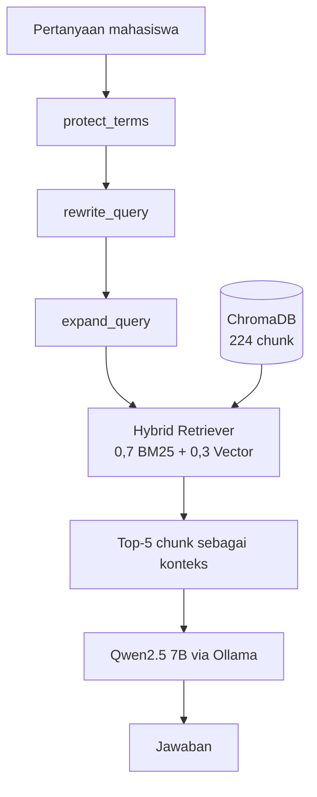

# AI Assistant Universitas Islam Riau

Chatbot berbasis **Hybrid RAG (Retrieval-Augmented Generation)** yang menjawab pertanyaan mahasiswa seputar Universitas Islam Riau (UIR) berdasarkan dokumen resmi kampus: informasi fakultas dan prodi, beasiswa, kalender akademik, layanan administrasi, panduan kerja praktek dan tugas akhir, pedoman akademik, serta pembayaran UKT.

Proyek ini dikembangkan sebagai skripsi Program Studi Teknik Informatika, Universitas Islam Riau.


## Latar Belakang

Informasi akademik di perguruan tinggi tersebar di banyak dokumen (pedoman, panduan, kalender, pengumuman), sehingga mahasiswa sering kesulitan menemukan jawaban yang tepat. Proyek ini membangun asisten yang mengambil konteks dari dokumen resmi, lalu menjawab hanya berdasarkan konteks tersebut. Jika informasi tidak ada, sistem menjawab bahwa informasinya tidak ditemukan, bukan mengarang.

## Fitur Utama

- **Hybrid retrieval**: menggabungkan BM25 (pencocokan kata kunci) dan vector search (kemiripan makna) dengan skor `0,7 × BM25 + 0,3 × Vector`.
- **Pemrosesan query**: perlindungan istilah khusus, query rewriting, dan query expansion sebelum retrieval.
- **LLM lokal**: Qwen2.5 7B melalui Ollama, tanpa biaya API dan tanpa mengirim data ke layanan pihak ketiga.
- **Guardrail jawaban**: prompt membatasi jawaban hanya pada konteks dokumen UIR.
- **Antarmuka chat** dengan Streamlit.
- **Evaluasi** retrieval (Precision@5, MRR) dan generation (RAGAS).

## Arsitektur



**Indexing (dijalankan sekali):** dokumen sumber dinormalisasi dan disusun dalam format JSON, dipecah menjadi chunk (total 224 chunk dari 8 dokumen), diubah menjadi vector dengan model `nomic-embed-text` (Ollama), lalu disimpan di ChromaDB.

**Cara kerja hybrid:** BM25 dan vector search masing-masing menghasilkan peringkat dokumen. Peringkat tersebut dikonversi menjadi skor, lalu digabung dengan bobot 0,7 untuk BM25 dan 0,3 untuk vector. Bobot ditentukan secara empiris agar pencocokan kata kunci (misalnya istilah akademik dan singkatan) mendapat porsi lebih besar tanpa mengabaikan pemahaman semantik.

## Dataset

8 dokumen resmi UIR yang dinormalisasi dan di-chunk secara manual, total 224 chunk:

| Dataset | File |
|---|---|
| Fakultas dan program studi | `fakultas&prodi.json` |
| Informasi beasiswa | `informasi_beasiswa.json` |
| Kalender akademik | `kalender-akademik.json` |
| Layanan administrasi akademik | `layanan_administrasi_akademik.json` |
| Panduan kerja praktek | `panduan_kp.json` |
| Panduan tugas akhir | `panduan_ta.json` |
| Pedoman akademik | `pedoman_akademik.json` |
| Pembayaran UKT | `pembayaran_ukt.json` |

## Hasil Evaluasi

Evaluasi menggunakan **24 pertanyaan uji** (3 pertanyaan per dataset). Relevansi konteks hasil retrieval dinilai secara manual. Pengujian dilakukan pada sistem hybrid.

### Retrieval

| Metrik | Hasil |
|---|---|
| **MRR** | **0,91** |
| Precision@5 (rata-rata) | 0,31 |

Rincian per dataset:

| Dataset | Mean P@5 | MRR |
|---|---|---|
| Fakultas & Prodi | 0,33 | 0,67 |
| Beasiswa | 0,20 | 1,00 |
| Kalender Akademik | 0,20 | 1,00 |
| Layanan Administrasi | 0,27 | 1,00 |
| Kerja Praktek | 0,27 | 0,61 |
| Tugas Akhir | 0,80 | 1,00 |
| Pedoman Akademik | 0,20 | 1,00 |
| Pembayaran UKT | 0,20 | 1,00 |

MRR keseluruhan dihitung sebagai rata-rata Reciprocal Rank dari seluruh 24 pertanyaan.

### Generation (RAGAS)

| Metrik | Nilai |
|---|---|
| Context precision | 0,83 |
| Context recall | 0,92 |
| Faithfulness | 0,74 |
| Answer relevancy | 0,54 |

### Interpretasi

- MRR yang tinggi menunjukkan sistem umumnya menempatkan konteks relevan di posisi teratas.
- Precision@5 yang rendah berarti jumlah konteks relevan di antara lima hasil teratas masih terbatas. Pemeringkatan atau penyaringan konteks adalah area perbaikan berikutnya.
- Kinerja terbaik pada pertanyaan faktual, cukup baik pada pertanyaan prosedural, dan paling lemah pada pertanyaan informatif yang membutuhkan konteks luas (tercermin pada answer relevancy 0,54).

## Teknologi

Python, ChromaDB, BM25, Ollama (`qwen2.5:7b` dan `nomic-embed-text`), Streamlit, RAGAS

## Cara Menjalankan

1. Install [Ollama](https://ollama.com), lalu unduh model:
   ```bash
   ollama pull qwen2.5:7b
   ollama pull nomic-embed-text
   ```
2. Install dependensi:
   ```bash
   pip install -r requirements.txt
   ```
3. Buat index vektor (sekali saja). Folder `chroma_db` tidak disertakan di repo:
   ```bash
   python -m src.ingest.embed_data
   ```
4. Jalankan aplikasi dari folder utama proyek:
   ```bash
   streamlit run app/streamlit_app.py
   ```
5. Jalankan evaluasi:
   ```bash
   python -m src.eval.evaluate_rag
   ```

Pastikan Ollama sedang berjalan sebelum menjalankan aplikasi.

## Struktur Proyek

```
app/
  streamlit_app.py     antarmuka chat
src/
  config/              pengaturan (host Ollama, dll.)
  ingest/              embedding data ke ChromaDB
  retrieve/            BM25, vector search, hybrid retriever, MRR
  rag/                 query rewriter, query pipeline, generator
  eval/                skrip evaluasi retrieval dan query rewriter
  utils/               protect terms, query expansion, logger
data/                  dokumen sumber (JSON) dan data evaluasi
requirements.txt
```

## Keterbatasan

- Hanya menjawab berdasarkan dokumen yang tersedia di folder `data/`; informasi di luar dokumen tidak dapat dijawab.
- Evaluasi memakai 24 pertanyaan dengan penilaian relevansi manual, sehingga hasilnya belum mencerminkan seluruh variasi pertanyaan pengguna.
- Sistem hanya diuji pada konfigurasi hybrid (bobot 0,7/0,3); belum dibandingkan dengan BM25 saja atau vector saja pada pertanyaan yang sama.
- Hanya pertanyaan terakhir yang diproses; percakapan multi-turn belum didukung.
- Kualitas jawaban bergantung pada model lokal berukuran 7B.

## Pengembangan Selanjutnya

- Menambah tahap reranking untuk meningkatkan Precision@5.
- Membandingkan hybrid dengan BM25 dan vector search pada kumpulan pertanyaan yang sama.
- Menampilkan sumber dokumen pada setiap jawaban.
- Menambah jumlah pertanyaan evaluasi dan mendukung percakapan multi-turn.

## Pengembang

Daztyn Daffa Danendra, Teknik Informatika, Universitas Islam Riau